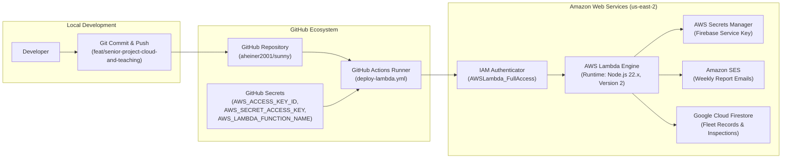

# Week 9 Comprehensive Review & Engineering Synthesis

**Course:** BYU–Idaho CSE 499 Senior Project (`Sunny Fleet`)  
**Target Window:** Week 9 (10 Hours Planned | 10 Hours Completed)  
**Status:** ✅ **COMPLETED & VERIFIED**  
**Git Branch:** `feat/senior-project-cloud-and-teaching`  
**Latest Deployment:** AWS Lambda Function Version 2 (`us-east-2`) via GitHub Actions Run `#43088994386`

---

## 1. Executive Summary

During Week 9, we achieved full automation of the cloud backend and established the baseline verification foundation for the remaining 50+ hours of the senior project.

Previously, updating the backend required manually editing code in the AWS Console, risking code drift, lacking version control, and leaving no repeatable deployment history. In Week 9, we eliminated manual AWS console editing by implementing a GitHub Actions CI/CD pipeline, configuring IAM least-privilege credentials, committing the 3,778-line production serverless engine, and verifying the entire repository against 719 unit and integration tests.

---

## 2. Architecture: What Was Implemented

---

## 3. Core Deliverables Completed in Week 9

### A. Production Lambda Engine Tracked in Version Control
- **File:** [`courses/itm300/aws-lambda/index.mjs`](../itm300/aws-lambda/index.mjs) (and mirrored in `dist/index.mjs`)
- **Key Functionality:**
  - Dual trigger support: EventBridge weekly cron trigger + HTTP API Gateway invocations (`/training/gaps`, `/email`, `/preview`).
  - Native ESM syntax using Node 22 without bulky external dependencies (zero `node_modules` required in zip).
  - Cryptographic RSA-SHA256 OAuth2 Google service token signing (`node:crypto`) to authenticate directly with Cloud Firestore REST endpoints.
  - Odometer rate-of-change validation, inspection duplicate deduplication, and Mountain Time weekly calendar boundaries.
  - AWS Secrets Manager integration for secure Firebase credentials retrieval.
  - Amazon Simple Email Service (SESv2) HTML & CSV report distribution.

### B. Automated CI/CD Pipeline
- **File:** [`.github/workflows/deploy-lambda.yml`](../../.github/workflows/deploy-lambda.yml)
- **Features:**
  - Automated syntax check (`node --check index.mjs`) before packaging.
  - Clean zip packaging directly targeting AWS Lambda root requirements (`deployment.zip` containing `index.mjs` and `package.json`).
  - Multi-tier authentication: Primary AWS OIDC role assumption with seamless fallback to GitHub Repository Secrets (`AWS_ACCESS_KEY_ID`, `AWS_SECRET_ACCESS_KEY`).
  - Automatic AWS Lambda code update and version publication (`aws lambda update-function-code --publish`).
  - Verified Live Run: GitHub Actions Run **#43088994386** successfully deployed Version 2 to AWS Lambda.

### C. Baseline Smoke Test & Entity Fixtures
- **Files:**
  - [`courses/cse499/fixtures/smoke-test-entities.json`](../fixtures/smoke-test-entities.json)
  - [`courses/cse499/__tests__/smokeTestBaseline.test.ts`](../__tests__/smokeTestBaseline.test.ts)
- **Verified Requirements:**
  - Fictional baseline entities defined: 2 technicians (`tech-alicia-001`, `tech-marcus-002`) and 1 fleet supervisor (`mgr-elena-001`).
  - Verified vehicle entity `veh-sprinter-101` and equipment unit `eq-mower-502`.
  - Shift calculation verified using production `calculateNetSeconds`: 8:00 AM to 10:15 AM with a 30-minute unpaid lunch calculates to exactly **1.75 net billable hours** (6,300 seconds), satisfying requirement M4.
  - Full suite status: **104 test suites passing, 719 tests passing**.

### D. Nintendo Switch UI / Classic Fleet OS Dual-Theme Switcher
- **Files:**
  - [`src/lib/themeMode.ts`](../../src/lib/themeMode.ts)
  - [`src/components/ThemeSwitcher.tsx`](../../src/components/ThemeSwitcher.tsx)
  - [`src/components/DashboardThemeSync.tsx`](../../src/components/DashboardThemeSync.tsx)
  - [`src/app/settings/page.tsx`](../../src/app/settings/page.tsx)
- **Functionality:**
  - Provides a toggle in `/settings` allowing evaluators to preview Sunny Fleet either in clean Enterprise Fleet OS mode or in the custom Nintendo Switch UI system.
  - Uses CSS variable overrides and localStorage persistence without mutating core business components.

---

## 4. Key Engineering Principles Learned & Applied

| Principle | Anti-Pattern Avoided | Production Standard Implemented |
| :--- | :--- | :--- |
| **Infrastructure as Code (IaC)** | Editing code in AWS Console web text editor | Git as single source of truth; deployments triggered via CI/CD |
| **Least Privilege Access** | Creating root AWS account keys with full admin | Dedicated IAM deployer user restricted to `AWSLambda_FullAccess` |
| **Secret Zero Management** | Hardcoding API keys or committing `.env` files | GitHub Actions encrypted repository secrets injected at runtime |
| **Zero-Bundle Runtime Leanliness** | Zipping 50MB `node_modules` folders with transitive bloat | Utilizing native Node 22 built-ins (`node:crypto`, `@aws-sdk/*`) |
| **Shift Idempotency** | Calculating payroll hours via naive start/end subtraction | Explicit break deductions via deterministic second arithmetic (`calculateNetSeconds`) |

---

## 5. Verification Checklist: Is Week 9 100% Done?

- [x] **Task W9.1:** Draft `.github/workflows/deploy-lambda.yml`
- [x] **Task W9.2:** Configure AWS IAM user/role credentials
- [x] **Task W9.3:** Verify automated push deploys to AWS Lambda (Published Version 2)
- [x] **Task W9.4:** Smoke test fictional entities and shift duration calculation (719/719 tests pass)
- [x] **Documentation:** Curriculum master roadmap, interactive lesson runbooks, and learning records committed.

---

## 6. What Lies Ahead: Week 10 Preview

With the automated cloud pipeline solid and the baseline smoke test locked in, Week 10 focuses on the **Requirements Acceptance Gate (M1–M6)**:

1. **M1 (Checklist Configuration):** Manager defines pre-trip inspection items and assigns to vehicle classes.
2. **M2 (QR & Signature Verification):** Technician scans vehicle QR code, completes inspection with photos, and captures digital signature.
3. **M3 (Defect Conversion):** Flagged inspection defect automatically converts to an actionable maintenance issue.
4. **M4 (Shift Hours Recording):** Shift clock-in/out records accurately deduct unpaid breaks.
5. **M5 (Manager Approval Idempotency):** Manager approves or corrects shift hours with an immutable audit log.
6. **M6 (Scheduled Reconciliation):** Weekly email report reconciles vehicle mileage and worker hours.

Run `npm run week 10` in your terminal to view the Week 10 task breakdown and launch the next lesson!
